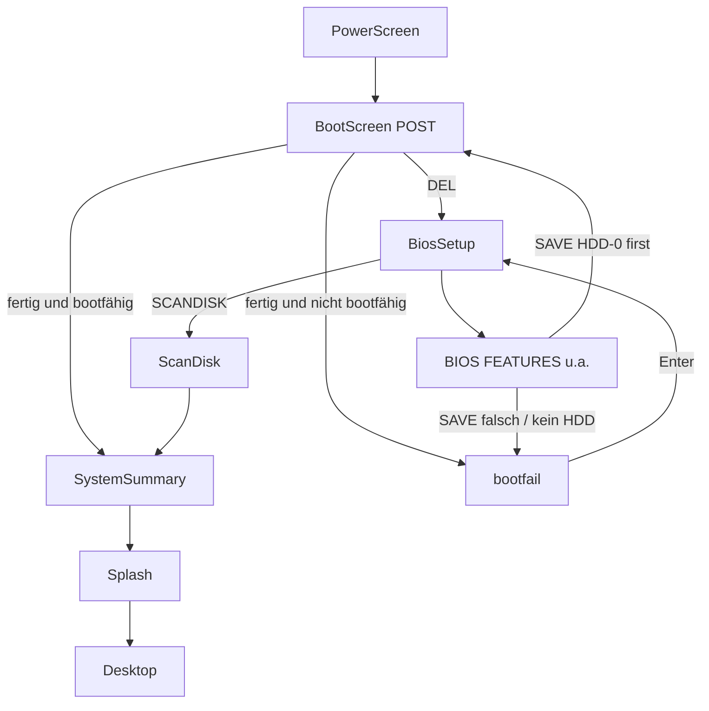

# Erweiterung des Boot-Menüs (Award CMOS Setup)

## Ausgangslage (Ist-Stand im Repo)
- **Phasen:** [src/App.tsx](src/App.tsx) — `power` → `black` → `post` → (`setup` | `scandisk`) → `summary` → `splash` → `desktop`; dazu `shutdown` / `dos`.
- **POST:** [src/boot/BootScreen.tsx](src/boot/BootScreen.tsx) spielt das Skript aus [src/boot/bootScript.ts](src/boot/bootScript.ts) ab: Award-Header (`Award Modular BIOS v4.51PG, An Energy Star Ally`), CPU-Zeile, **Memory Test** 0…65536K OK (rAF), PnP-Zeilen, IDE Primary Master `ST34311A`, Slave mit `[Press F4 to skip]`, Footer `Press DEL to enter SETUP` + BIOS-ID. Logos: [src/boot/BoardLogo.tsx](src/boot/BoardLogo.tsx), [src/boot/EnergyStarLogo.tsx](src/boot/EnergyStarLogo.tsx) (`/img/energy-star.png`).
- **Setup:** [src/boot/BiosSetup.tsx](src/boot/BiosSetup.tsx) — zweispaltiges Award-"CMOS SETUP UTILITY", Navigation Pfeiltasten, Styles `.setup-screen` / `.setup-item.is-selected` in [src/index.css](src/index.css). Menülabels aus `setupMenu` in `bootScript.ts`.
- **Nur ein funktionaler Punkt:** `MICROSOFT SCANDISK` → [src/boot/ScanDisk.tsx](src/boot/ScanDisk.tsx). `SAVE & EXIT` / `EXIT WITHOUT SAVING` / ESC / F10 rufen nur `onExit` → `boot(false)`. Übrige Einträge sind tote Labels.
- **Overlay:** Fester Dialog „Welcome to the 90s…“ blockiert faktisch die Nutzung echter Unterseiten.
- **System Summary:** [src/boot/SystemSummary.tsx](src/boot/SystemSummary.tsx) — Box mit CPU/Memory/IDE, PCI-Listing, `Verifying DMI Pool Data ……` (Punkte-Animation). Entspricht dem klassischen Award-/Phoenix-Summary nach POST.
- **Hardware-Fiktion:** `machine.hddModel` = `ST34311A` (4327 MB) = Desktop-Laufwerk `(C:)` in [src/apps/explorer/folders.ts](src/apps/explorer/folders.ts) / [src/apps/SystemApp.tsx](src/apps/SystemApp.tsx).
- **Audio:** [src/audio/audio.ts](src/audio/audio.ts) — `bios-startup.mp3`, Lüfter, `tone()` (Rechteckwelle); kein Disk-Boot-Failure-Piep. **Settings:** [src/settings/settings.ts](src/settings/settings.ts) ohne CMOS-Felder.

## Historischer Kontext (Award / AMI / Phoenix)
Das Projekt bildet bewusst **Award Modular BIOS ~v4.51PG** nach (Textzeilen, blaues Setup, Energy-Star-Ally). Zum Abgrenzen und für glaubwürdige Details:

| Familie | Typisches Look & Feel | Setup-Einstieg | Boot-Optionen |
|---------|----------------------|----------------|---------------|
| **Award** (hier Zielbild) | Schwarzer POST, cyan/weiß; Setup tiefblau `#0000AA`, gelbe Selection, zweispaltiges Hauptmenü | `Press DEL to enter SETUP` | Älter: `Boot Sequence` A,C / C,A; neuer (4.5x+): First/Second/Third Boot Device; Quick Power-On Self Test; Boot Up Floppy Seek; Boot Up NumLock; Virus Warning; Security Option Setup/System |
| **AMI** (AMIBIOS) | Oft grau/blau HIFLEX, andere Menünamen | `Hit DEL if you want to run setup` | Quick Boot; 1st/2nd/3rd Boot Device; Floppy Drive Seek; BootUp Num-Lock; Password Check; Optimal/Fail-Safe Defaults |
| **Phoenix** (4.0 / später Phoenix-Award) | Graue Tab-UI oder QuietBoot-Grafik; MultiBoot „Boot First Menu“ | Setup prompt ein/aus; ESC/F2 je nach OEM | Boot sequence A then C / C then A; Floppy check; Summary screen; POST Errors |

**Quellen (kurz):**
- Award CMOS Setup / Features: [Award BIOS 4.50 Guide (arxvaldex)](https://www.arxvaldex.com/pb/files/manuals/BIOS/450GEN.pdf), [dosdays Award generic PDF](https://dosdays.co.uk/media/award/bios-award-generic.pdf) (Fehlertexte inkl. `DISK BOOT FAILURE, INSERT SYSTEM DISK AND PRESS ENTER`), Mainboard-Manual z. B. [RetroWeb 6EMM BIOS](https://theretroweb.com/motherboard/manual/6emm-10-1-may0598-b-61b34e03ef583416088547.pdf).
- AMI: [MSI AMIBIOS User's Guide](https://www.gdt.id.au/~gdt/manuals/msi-6178/e61781-10c/6178-4.pdf) (Hit DEL, Advanced CMOS, Quick Boot, Boot Devices).
- Phoenix: [PhoenixBIOS 4.0 Rev. 6 User's Manual (bitsavers)](https://bitsavers.org/pdf/phoenix/PhoenixBIOS_4.0_Users_Manual_2000.pdf) (Boot Options, Setup prompt, Floppy seek, Summary screen, QuietBoot/MultiBoot).

Wir **wechseln nicht** zu AMI/Phoenix-UI — nur Optionen und Verhaltensdetails übernehmen, die Award-Nutzer 1998–2000 erwartet hätten.

## Ziele
1. Mehrere Setup-Punkte **originalgetreu** animieren und funktional machen (nicht nur Labels).
2. **Boot-Reihenfolge** steuert den echten Boot: Default = Projekt-Festplatte; sonst kein Windows.
3. Bei Fehlboot: Award-Meldung + PC-Speaker-Fehlerton.
4. CMOS-Schalter wirken spürbar auf den **POST** (Quick Boot, Floppy Seek, Prompt).
5. Zurückhaltende Easter Eggs — retro, nicht verspielt.

---

## 1. Unterseiten-Framework in `BiosSetup`
- Zustand `view: 'main' | pageId`; Enter öffnet, ESC zurück zum Hauptmenü; F10 = Save & Exit (mit Confirm).
- Layout beibehalten: Titel `ROM PCI/ISA BIOS (2A69KA1J)` / `CMOS SETUP UTILITY` / `AWARD SOFTWARE, INC.`, Fuß `Esc : Quit` / `↑↓←→ : Select Item` / auf Unterseiten zusätzlich `Pu/Pd/+/- : Modify`, `F1 : Help` (optional Item-Help unten, wie Phoenix Item Specific Help — bei Award oft Statuszeile).
- Save/Exit-Confirm wie Original: kleines Doppelrahmen-Fenster „SAVE to CMOS and EXIT (Y/N)?“ bzw. „Quit Without Saving (Y/N)?“.
- ScanDisk-Pfad unverändert (`onScanDisk`).
- Welcome-Dialog nur noch als Easter Egg (erster Besuch oder Konami), damit Unterseiten bedienbar sind.

## 2. `BIOS FEATURES SETUP` — Kernseite
Zweispaltige Feldliste (Award-Stil), Werte per `+/-` oder PgUp/PgDn:

| Option | Default | Wirkung im Projekt |
|--------|---------|-------------------|
| **Virus Warning** | Disabled | Enabled: beim nächsten „Boot“ einmalig Award-Warntext `! WARNING ! Disk boot sector is to be modified…` (nur kosmetisch / Pause mit Y/N) |
| **CPU Internal/External Cache** | Enabled | Anzeige; Disabled → kurzer Hinweis im Summary „Cache Disabled“ |
| **Quick Power On Self Test** | Enabled | **Koppelt an POST:** Enabled kürzt `memoryDurationMs` und IDE-Delays in [src/boot/BootScreen.tsx](src/boot/BootScreen.tsx); Disabled = heutiges langsames Hochzählen |
| **First / Second / Third Boot Device** | HDD-0 / CDROM / Floppy | Steuert Boot-Erfolg (Abschnitt 3) |
| **Boot Up Floppy Seek** | Enabled | Enabled: kurzes Floppy-Seek-Geräusch (`tone` oder bestehendes Seek-Feeling) + 200–400 ms Pause nach Memory-Test; Disabled = überspringen (wie Phoenix „Floppy check“) |
| **Boot Up NumLock Status** | On | Merkt `cmos.numLock`; optional Taskleisten-/Desktop-Hinweis oder nur CMOS-Echo (Browser kann echte NumLock selten setzen) |
| **Gate A20 Option** | Fast | Rein kosmetisch |
| **Typematic Rate/Delay** | Disabled / 6 / 250 | Optional: beeinflusst Tastatur-Wiederholung nur im Setup selbst |
| **Security Option** | Setup | Setup = Passwort nur für DEL-Setup; System = zusätzlich Boot-Prompt vor Windows |

**Default Boot Device = `HDD-0`** (= `machine.hddModel` / C:), damit Besucher ohne Setup-Besuch unverändert Windows erreichen.

## 3. Boot-Reihenfolge → Windows oder Failure
**Regel:** Phasen `summary` → `splash` → `desktop` nur, wenn das erste *wirksame* bootfähige Gerät die Systemplatte ist (`hddPresent && first usable === 'HDD-0'`).

Blockiert Windows:
- First = Floppy oder CDROM (Simulation: Laufwerke immer leer / kein System).
- Sequenz ohne HDD-0 / First = Disabled.
- `hddPresent: false` (IDE Auto Detection „None“ oder HDD aus Priority entfernt).

Ablauf nach SAVE & EXIT:
1. Optional kurzer POST-Nachlauf oder direkt Fehlerphase.
2. Neue Phase `bootfail` in [src/App.tsx](src/App.tsx): schwarzer `.bios-screen`, VGA-Font.
3. **Award-Originaltext:**

> DISK BOOT FAILURE, INSERT SYSTEM DISK AND PRESS ENTER

   (Quelle: Award POST Error Messages, dosdays Award-PDF.)  
   Variante bei First=Floppy optional: `Non-System disk or disk error` / `Replace and strike any key when ready` (DOS/IBM-Floppy-Pfad) — klar kennzeichnen, nicht vermischen.

4. Enter → zurück zu `setup` (oder POST), damit man korrigieren kann. Escape-Skip-to-Desktop in `bootfail` **aus** (oder nur versteckter Chord), sonst entfällt das Gimmick.

## 4. BIOS-Fehler-Piep
- `playDiskBootFailureBeep()` in [src/audio/audio.ts](src/audio/audio.ts) via `tone()` (Rechteck ~1 kHz).
- Muster: ein längerer Piep oder kurze Wiederholschleife, bis Enter — an POST-Beep-Codes angelehnt, ohne MP3.
- Lautstärke: `effectiveVolume()` / Mute.

## 5. POST an CMOS koppeln (Animationen & Hinweise)
Bereits vorhanden und bewusst **beibehalten/verfeinern**:
- Memory-Zähler (`formatMemory`, rAF) — Tempo über Quick Boot.
- Energy-Star-Logo + Board-Logo.
- `Press DEL to enter SETUP` + BIOS-Datumszeile — abschaltbar analog Phoenix „Setup prompt“ / AMI „Hit DEL Message Display“ als Option `Show Setup Prompt` in Features (Default Enabled).
- IDE-Detect-Zeilen; F4 skip Slave.
- Summary mit DMI-Punkten — abschaltbar analog Phoenix „Summary screen“ (Default Enabled; Disabled → nach POST direkt Splash, wenn bootfähig).

Neu / schärfen:
- Einmaliger POST-OK-Piep beim Memory-Test-Ende (Web-Audio, wie im Portfolio-Plan skizziert), getrennt vom Failure-Piep.
- Floppy-Seek-Animation: kurze Zeile `Floppy drive(s) seek …` oder nur akustisch.
- DEL akzeptieren während Memory-Test und danach (wie jetzt: `setupRequested` + `selfTestDone`) — Zeitfenster dokumentieren, nicht verkleinern.

## 6. Weitere Menüpunkte (Priorität)
| Menüpunkt | Umsetzung |
|-----------|-----------|
| `STANDARD CMOS SETUP` | Date/Time aus Browser; Drive A `1.44M, 3.5 in.`; Drive B None; IDE Pri Master Typ/Größe aus `machine`; Halt On All Errors (kosmetisch) |
| `CHIPSET FEATURES SETUP` | Read-only/wenige Toggles (SDRAM Timing aus `machine.sdramRows`) |
| `POWER MANAGEMENT SETUP` | Green PC / Power Management = Enabled; Doze/Standby/Suspend Zeiten; optional Brücke zur späteren Energieverwaltung |
| `PNP/PCI CONFIGURATION` | Resources Controlled By = Auto; PCI-IRQ-Tabelle an Summary-Devices angelehnt |
| `INTEGRATED PERIPHERALS` | Onboard IDE, Floppy Controller, Serial/Parallel aus `machine` |
| `LOAD BIOS DEFAULTS` / `LOAD SETUP DEFAULTS` | Confirm Y/N; setzt `cmos` zurück (BIOS = fail-safe/konservativ, Setup = „optimized“ inkl. Quick Boot On) — analog AMI Optimal/Fail-Safe, aber Award-Wortlaut behalten |
| `SUPERVISOR` / `USER PASSWORD` | Enter Password-Dialog; leeres Feld = clear; Security Option greift |
| `IDE HDD AUTO DETECTION` | Animiertes Detecting…; Ergebnis `ST34311A` oder None → `hddPresent` |
| `MICROSOFT SCANDISK` | Unverändert |
| `SAVE & EXIT` / `EXIT WITHOUT SAVING` | Confirm; Save wertet Boot-Order aus |

## 7. Cooles, aber retro-treu
Leitplanke: wirkt wie vergessenes OEM-Detail, nicht wie Minispiel-Sammlung.

1. **Welcome-Dialog** nur nach Konami oder geheimen F10+F10 — sonst weg vom Hauptmenü.
2. **Supervisor-Passwort `sa85` / `90s`:** öffnet schlichte OEM-Seite (BIOS-String, Build, Credits) in VGA-Text — kein buntes UI.
3. **Virus Warning Enabled** + „Schreiben“ simulieren: originaler Award-Warnblock, Y/N.
4. **Seltener CMOS CHECKSUM ERROR** nach absichtlichem Corrupt-Flag → erzwungene Defaults (klassischer Schock).
5. **Floppy-First-Failure:** Enter auf Failure-Screen startet optional 10-Sekunden „Insert system disk“-Warteschleife mit blinkendem Cursor — kein Score, kein Highscore.
6. **IDE Detection 1:50:** erkennt kurz `QUANTUM FIREBALL` → bootfail bis Defaults.
7. **F4 auf bootfail:** stoppt nur den Piep-Loop (Echo der POST-Zeile).
8. **Phoenix MultiBoot light (optional, versteckt):** während POST `Esc` öffnet einmalig textbasiertes „Boot Menu“ (HDD-0 / CDROM / Floppy) ohne Setup — nur wenn Feature-Flag; optisch Award-schwarz, nicht Phoenix-grau.

## Ablauf


## Neue Einstellungen in `settings.ts`
```ts
cmos: {
  bootOrder: ['HDD-0', 'CDROM', 'Floppy'],
  hddPresent: true,
  quickBoot: true,
  floppySeek: true,
  numLock: true,
  virusWarning: false,
  showSetupPrompt: true,
  showSummary: true,
  securityOption: 'setup' | 'system',
  supervisorPassword: string | null,
  // …
}
```
Defaults so wählen, dass **Erstbesucher ohne DEL** denselben Weg wie heute sehen (voller oder Quick-POST → Summary → Splash → Desktop).

## Prüfung
`npm run typecheck`. Manuell:
1. Kaltstart ohne Setup → Windows wie bisher.
2. DEL → BIOS FEATURES → First=Floppy → SAVE → `DISK BOOT FAILURE…` + Piep → Enter → First=HDD-0 → SAVE → Splash/Desktop.
3. Quick Boot Off → spürbar längerer Memory-Test; Floppy Seek Off → kein Seek-Pause.
4. IDE Auto Detection → None → Failure; Load Setup Defaults → wieder bootfähig.
5. ScanDisk, EXIT WITHOUT SAVING, Escape-Skip auf normalen Phasen regressen; Escape auf `bootfail` blockiert.
