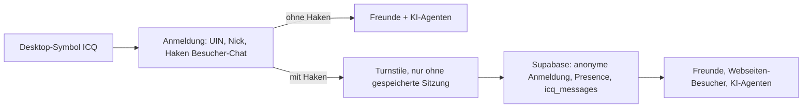

# ICQ 2001b

## Ablauf

- UIN und Nick sind zufällig vorbelegt, „Neue Nummer & Nick“ würfelt neu. Die letzte Wahl liegt in `localStorage` (`sa85.icq`).
- Freunde sind nur Kontakte, die man selbst hinzufügt (Rechtsklick oder langes Tippen, oder „Add/Invite Users“).
- Sprache: Deutsch bei Systemsprache Deutsch, sonst Englisch (`src/apps/icq/strings.ts`).
- Nachrichten- und Dialogfenster rendern per Portal über dem Desktop, damit mehrere Chats gleichzeitig offen sein können.

## Server

- Schema, Zugriffsregeln, Echtzeit und Aufräumen: `supabase/icq.sql` (einmal im SQL-Editor ausführen).
- Daten älter als 7 Tage löscht `pg_cron` täglich, ebenso die anonymen Konten ohne Besuch.
- Umgebungsvariablen siehe `.env.example`. Ohne Supabase-Werte ist der Haken ausgegraut.
- Captcha: `VITE_TURNSTILE_SITE_KEY` im Frontend, Secret-Key in Supabase unter Attack Protection. Erst einschalten, wenn der Code live ist.
- Netlify-CSP erlaubt `https://challenges.cloudflare.com` in `frame-src`.
