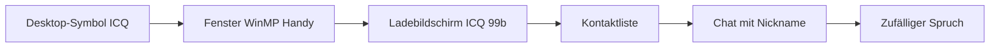

# ICQ 99b auf dem WinMP Handy

## Ablauf

- Beim Laden der Seite bleibt ICQ zu. Kein Eintrag in `initialApp`, kein Effekt in `Desktop.tsx`, kein Schnellstart.
- Doppelklick auf das Blumen-Symbol (oder der Eintrag im Startmenü) öffnet das Fenster **WinMP Handy**.
- Der Bildschirm des Handys zeigt zuerst den Verbindungsbildschirm, danach die Kontaktliste.
- Ein Tipp auf einen Nickname öffnet den Chat. Enter oder „Senden“ schickt den Text, der Nickname antwortet nach kurzer Pause mit einem zufälligen Spruch. Der Verlauf bleibt, solange das Fenster offen ist.

## Aussehen

- Äußeres Fenster und Handy-Gehäuse nutzen die Windows-98-Fläche `#c0c0c0`, versenkte und erhabene Kanten, MS Sans Serif und die blaue Titelleiste.
- Die Blume ist ein eigenes Symbol, angelehnt an den ICQ-99-Client: helle Blüten, gelbe Mitte, grüner Rand. Der Status färbt sie grün, gelb, rot oder grau.
- Kontaktliste mit Gruppen Online, Abwesend, Beschäftigt und Offline, UIN und Statustext.

## Kontakte

Erfundene Nicknames im kurzen Vornamen-Stil, keine echten Personen:

| Nickname | Status | Text |
| --- | --- | --- |
| Philipp | Online | bin da :) |
| Svenny | Online | wer zockt C&C? |
| Marco98 | Abwesend | BRB, Pizza |
| Kevinski | Beschäftigt | Mathe. Ernsthaft. |
| BastiBombe | Offline | seit Dienstag weg |

Der eigene Nickname auf dem Handy ist `sa85`. Es gibt keine Netzwerkverbindung.
