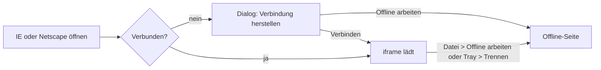

# Rechtliches für sa85 im Windows-98-Stil

## Rechtliche Einschätzung (keine Rechtsberatung)

- **Cookie-Banner: nicht nötig.** Es gibt keine Cookies, kein Tracking und die Schriften liegen lokal. Im `localStorage` stehen nur `sa85-settings` (siehe [src/settings/settings.ts](/Users/sandernach/AAAI/sa85/src/settings/settings.ts)) und `sa85-dst-*` (siehe [src/utils/dst.ts](/Users/sandernach/AAAI/sa85/src/utils/dst.ts)). Beide dienen Funktionen, die der Besucher selbst nutzt, und fallen unter die Ausnahme in § 25 Abs. 2 Nr. 2 TDDDG. Beides muss trotzdem in der Datenschutzerklärung stehen.
- **Retro-Browser: Einwilligung beim Öffnen.** Beim Laden geht die IP-Adresse an das Internet Archive (USA) und an die Live-Seiten, die außerdem eigene Cookies setzen können. Rechtsgrundlagen dafür: Einwilligung nach Art. 6 Abs. 1 lit. a und Art. 49 Abs. 1 lit. a DSGVO sowie § 25 Abs. 1 TDDDG. Umgesetzt wird das über einen Einwahl-Dialog, und „Offline arbeiten“ widerruft die Einwilligung.
- **Impressum: Pflicht.** Grundlage ist § 5 DDG (berufliche Visitenkarte), mindestens aber § 18 Abs. 1 MStV. Nötig sind Name, eine ladungsfähige Anschrift (kein Postfach), die E-Mail-Adresse und ein zweiter schneller Kontaktweg. Als zweiten Weg schließen wir das Kontaktformular über Netlify Forms an, eine Telefonnummer ist dann nicht nötig. Eine USt-IdNr. gibt es nicht, die Angabe entfällt.
- **Datenschutzerklärung: Pflicht** (Art. 13 DSGVO).
- **Erreichbarkeit:** Impressum und Datenschutz müssen von jedem Zustand aus mit höchstens zwei Klicks erreichbar und klar beschriftet sein. Das gilt auch für den Power-Screen, das BIOS und den Splash.
- **Nicht nötig:** Link zur OS-Plattform (abgeschaltet seit 20.07.2025), Hinweis nach VSBG, Barrierefreiheit nach BFSG (kein E-Commerce) und Haftungsausschluss-Textbausteine.
- **Marken und Lizenzen:**
  - „Stefan®“ und „Andernach®“ im Splash sind ohne eingetragene Marke irreführend (§ 5 UWG). Ersatz: ™.
  - Die VGA-Schrift steht unter CC BY-SA 4.0 und braucht eine sichtbare Namensnennung.
  - Für das Microsoft-Material (Sounds, Splash, Logo, MS Sans Serif) kommt ein Hinweis „Fanprojekt, keine Verbindung zu Microsoft“. Ein Restrisiko beim Urheberrecht bleibt.

## 1. Inhalte an einer Stelle

Neue Datei `src/content/legal.ts` mit strukturierten Abschnitten (Überschrift, Absätze, Links). Name, E-Mail und Ort kommen aus [src/content/profile.ts](/Users/sandernach/AAAI/sa85/src/content/profile.ts), damit sie nur an einer Stelle stehen.

- **Anbieter (fest):** Stefan Andernach, In der Mühlhöll 10 A, 56332 Dieblich, E-Mail business@sa85.de. Zweiter Kontaktweg ist das Kontaktformular, verlinkt auf das Kontakt-Fenster. Ohne USt-IdNr.
- **Impressum:** Angaben nach § 5 DDG und ein Abschnitt „Marken & Lizenzen“: Hinweis auf die Marken von Microsoft, Netscape, Winamp und Energy Star sowie Credits für die Schrift von VileR (int10h.org, CC BY-SA 4.0) und für react95.
- **Datenschutz:**
  - Verantwortlicher (Anschrift wie oben)
  - Hosting bei Netlify, Inc. (USA): Server-Logfiles mit IP-Adresse, Browser und Zeitpunkt, Rechtsgrundlage Art. 6 Abs. 1 lit. f. Auftragsverarbeitung über Netlifys Data Processing Addendum mit Standardvertragsklauseln. Netlifys aktuelle Anschrift und die Zertifizierung nach dem EU-US Data Privacy Framework prüfe ich bei der Umsetzung auf netlify.com nach und trage sie ein.
  - Speicherung im Browser (beide Schlüssel, Zweck, Löschen über den Browser)
  - Kein Tracking
  - Externe Inhalte im Retro-Browser: Internet Archive und die Live-Hosts aus [src/content/web.ts](/Users/sandernach/AAAI/sa85/src/content/web.ts), Einwilligung, Widerruf über „Offline arbeiten“
  - Kontaktformular über Netlify Forms. Die Angaben werden bei Netlify gespeichert, Netlify filtert Spam über Akismet (Automattic, als Unterauftragsverarbeiter von Netlify) und schickt eine Benachrichtigung an business@sa85.de. Rechtsgrundlage ist Art. 6 Abs. 1 lit. b bzw. f, gelöscht wird nach Abschluss der Anfrage. Der Anbieter des Postfachs (vermutlich Microsoft 365) wird bei der Umsetzung geprüft und eingetragen.
  - LinkedIn-Link (Daten fließen erst beim Klick)
  - Rechte der Betroffenen, Aufsichtsbehörde LfDI Rheinland-Pfalz
  - Stand

## 2. Fenster im Stil des Editors

- Neue Datei `src/apps/LegalApp.tsx` mit den Exporten `ImpressumApp` und `DatenschutzApp`. Aufbau wie der Win98-Editor: eine Menüleiste „Datei Bearbeiten Suchen ?“ als Attrappe und darunter ein weißes, scrollbares Textfeld mit Überschriften in Großbuchstaben. Links sind klickbar, ein Link auf das jeweils andere Dokument öffnet das andere Fenster über `openApp`.
- In [src/apps/registry.tsx](/Users/sandernach/AAAI/sa85/src/apps/registry.tsx) kommen zwei `kind: 'window'`-Einträge `impressum` und `datenschutz` dazu, mit dem `Notepad`-Icon, als Desktop-Icon und mit einer neuen `startMenuGroup: 'legal'`.
- [src/desktop/StartMenu.tsx](/Users/sandernach/AAAI/sa85/src/desktop/StartMenu.tsx) zeigt die Einträge der Gruppe `legal` über „Beenden...“, getrennt durch einen Separator. Das ist die Stelle, an der in Win98 „Hilfe“ stand.

## 3. Immer erreichbar

- **Taskleiste** ([src/desktop/Taskbar.tsx](/Users/sandernach/AAAI/sa85/src/desktop/Taskbar.tsx)): Eine kleine Symbolleiste „Links“ mit Griff und den Text-Buttons „Impressum“ und „Datenschutz“ links neben dem Infobereich. Auf schmalen Bildschirmen wird zuerst die Schnellstartleiste ausgeblendet, die beiden Buttons bleiben sichtbar.
- **Boot-Phasen** ([src/App.tsx](/Users/sandernach/AAAI/sa85/src/App.tsx)): Eine neue Komponente `LegalLinks` wird in allen Phasen außer `desktop` fest unten rechts eingeblendet. Auf Power-Screen und BIOS erscheint sie in VGA-Schrift grau auf schwarz, auf dem Splash als kleiner weißer Text. Ein Klick ruft `skipToDesktop()` auf und öffnet das Fenster.
- **Deep Links:** `/impressum` und `/datenschutz` starten direkt im Desktop (`Desktop` bekommt die Prop `initialApp`) und öffnen das passende Fenster. So lassen sie sich zum Beispiel in einer E-Mail-Signatur verlinken. Die Netlify-Umleitung auf `/index.html` deckt das schon ab.
- **Ohne JavaScript:** Ein `<noscript>`-Block in [index.html](/Users/sandernach/AAAI/sa85/index.html) enthält die Kurzangaben des Impressums.

## 4. Einwahl-Dialog im Retro-Browser

- Neue Datei `src/apps/browser/connection.ts`: ein gemeinsamer Verbindungsstatus für IE und Netscape, nach dem Muster `useSyncExternalStore` wie in `settings.ts`. Er gilt standardmäßig nur für die Sitzung. Wer die Checkbox „Automatisch verbinden“ setzt, bekommt `autoConnect` in `sa85-settings` gespeichert. Das Speichern der Einwilligung selbst ist zulässig.
- Neue Datei `src/apps/browser/DialupDialog.tsx`: Der Dialog „Verbindung herstellen“ im Stil des DFÜ-Netzwerks mit einem `Rnaui`-Icon aus `@react95/icons`. Er zeigt die Attrappen-Felder „Benutzername: gast“ und „Wählen von: Koblenz“ und einen kurzen Hinweistext: Inhalte kommen vom Internet Archive (USA) und von Retro-Seiten, die IP-Adresse wird übertragen, Cookies sind möglich, dazu ein Link zum Datenschutz. Buttons: „Verbinden“ und „Offline arbeiten“. Nach dem Klick folgt optional eine kurze Statusabfolge („Wählen...“, „Verbunden mit 56.000 bps“).
- [src/apps/BrowserApp.tsx](/Users/sandernach/AAAI/sa85/src/apps/BrowserApp.tsx): Solange keine Verbindung besteht, zeigt der Browser den Dialog statt des iframes, und die Statusleiste meldet „Offline“. Im Menü „Datei“ kommt der Eintrag „Offline arbeiten“ dazu: Er trennt die Verbindung und setzt `autoConnect` zurück.
- Taskleiste: Solange eine Verbindung besteht, steht im Infobereich das DFÜ-Icon mit zwei Computern. Ein Klick öffnet das Menü „Trennen“, über das sich die Einwilligung jederzeit widerrufen lässt.

## 5. Kontaktformular über Netlify Forms

- Neue Datei `public/__forms.html` mit einem versteckten statischen Formular `name="contact"`, `data-netlify="true"` und `netlify-honeypot="company"`. Es enthält die Felder `name`, `email`, `subject`, `message` und `company`. Netlify erkennt Formulare nur in statischem HTML, deshalb braucht die React-App diese Definition.
- [src/contact/sendContact.ts](/Users/sandernach/AAAI/sa85/src/contact/sendContact.ts): Der Platzhalter wird durch ein `fetch('/__forms.html', { method: 'POST' })` ersetzt, mit `application/x-www-form-urlencoded` und `form-name=contact`. Liefert der Server keinen Erfolgsstatus, wirft die Funktion einen Fehler. Der Kommentar zu Microsoft Graph entfällt.
- [src/apps/ContactApp.tsx](/Users/sandernach/AAAI/sa85/src/apps/ContactApp.tsx):
  - Die Erfolgsmeldung lautet künftig „Die Nachricht wurde gesendet.“
  - Über den Buttons steht der Hinweis „Ihre Angaben werden nur zur Bearbeitung Ihrer Anfrage verwendet. Details: Datenschutz“. Der Link öffnet das Datenschutz-Fenster.
  - Eine Checkbox gibt es nicht, denn die Rechtsgrundlage ist Art. 6 Abs. 1 lit. b bzw. f.
- Lokal mit `vite` schlägt das Senden fehl und zeigt die bestehende Fehlermeldung. Funktionieren wird es erst auf Netlify (oder mit `netlify dev`).

## 6. Kleinere Punkte
- [src/splash/SplashScreen.tsx](/Users/sandernach/AAAI/sa85/src/splash/SplashScreen.tsx): Beide `®` werden zu ™.

## Nach dem Deploy im Netlify-Konto

- Unter Forms die Formularerkennung einschalten (bei neuen Sites ist sie standardmäßig aus).
- Unter Forms eine E-Mail-Benachrichtigung an business@sa85.de anlegen.
- Prüfen, ob das Data Processing Addendum akzeptiert ist (Team-Einstellungen bzw. Netlify-Bedingungen).
- Erledigte Einsendungen regelmäßig in Netlify löschen, so wie es in der Datenschutzerklärung steht.