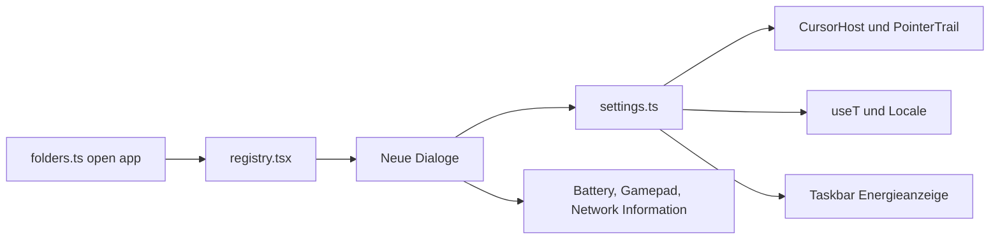

# Neue Systemsteuerungs-Applets mit Gimmicks

## Ausgangslage
- In [sa85/src/apps/explorer/folders.ts](sa85/src/apps/explorer/folders.ts) haben `users`, `power`, `joystick`, `regional`, `mouse`, `network` noch kein `open: { app: ... }`.
- Muster für Dialoge: [sa85/src/apps/SystemApp.tsx](sa85/src/apps/SystemApp.tsx) (Tabs, `props-dialog`, `DialogFooter`, Entwurf lokal halten, bei OK/Übernehmen `updateSettings`).
- Einstellungen persistieren über [sa85/src/settings/settings.ts](sa85/src/settings/settings.ts) (localStorage, `useSettings`).
- Jede App wird in [sa85/src/apps/registry.tsx](sa85/src/apps/registry.tsx) als `kind: 'window'`, `showOnDesktop: false`, `showInStartMenu: false` eingetragen.

Die Layouts orientieren sich an den Original-Dialogen von Windows 98 (Tab-Namen und Anordnung siehe unten). Beim Umsetzen gleiche ich Details mit Screenshots aus der Websuche ab.

## 1. Maus (`MouseApp.tsx`) - "Eigenschaften von Maus"
Tabs wie im Original: **Tasten**, **Zeiger**, **Bewegung**.
- **Tasten:** Rechtshänder/Linkshänder mit Mausgrafik, Doppelklickgeschwindigkeit (Regler) mit Testbereich (Schachtelteufel springt bei erkanntem Doppelklick heraus).
- **Zeiger:** Schema-Auswahl (Windows-Standard, Windows-Standard groß, 3D-Zeiger, Animierte Sanduhren, Schwarz, Invertiert) und Liste der Zeigerrollen (Normal, Hilfe, Hintergrund, Beschäftigt, Präzision, Text, Nicht verfügbar, Größe ändern, Verschieben, Link). Knopf **Durchsuchen...** zum Hochladen eigener SVG, PNG, ICO oder CUR-Dateien pro Rolle. Knopf **Standard** setzt zurück.
- **Bewegung:** Zeigergeschwindigkeit (Regler, wird gespeichert, mit Hinweis, dass Browser die Systemgeschwindigkeit nicht ändern dürfen) und **Mausspur** an/aus mit Längenregler (echt wirksam).

Technik:
- Neues Modul `src/cursors/` mit Win98-Zeigern als selbst gezeichnete Pixel-SVGs (Data-URLs) plus Hotspot je Rolle.
- Upload: Datei per `Image` laden, auf Canvas auf 32x32 skalieren und als PNG-Data-URL speichern. So funktioniert ICO auch in Safari, und der localStorage bleibt klein (Größenlimit prüfen).
- Anwenden: Die rund 35 `cursor:`-Angaben in [sa85/src/index.css](sa85/src/index.css) auf CSS-Variablen umstellen (`cursor: var(--cur-default)` usw.). Ein `CursorHost` setzt die Variablen auf `:root`, z. B. `url(data:...) 0 0, default`. react95-Bausteine bekommen eine globale Regel für Buttons und Eingabefelder.
- Mausspur: `PointerTrail`-Komponente (Canvas oder ein paar absolut positionierte Bilder), läuft hinter `pointer-events: none`.
- Doppelklick: neuer Hook `useDoubleActivate(threshold)` ersetzt `onDoubleClick` in [sa85/src/desktop/DesktopIcon.tsx](sa85/src/desktop/DesktopIcon.tsx) und [sa85/src/apps/explorer/Explorer.tsx](sa85/src/apps/explorer/Explorer.tsx), damit die eingestellte Geschwindigkeit wirkt.
- Linkshänder: Primär- und Sekundärtaste werden auf dem Desktop und in Explorer-Symbolen vertauscht (Rechtsklick markiert/öffnet). Kontextmenüs gibt es derzeit kaum, daher bleibt der Eingriff klein.

## 2. Ländereinstellungen (`RegionalApp.tsx`)
Tabs wie im Original: **Ländereinstellungen** (Dropdown plus Weltkarte, Karte aus `DateTimeApp` wiederverwenden), **Zahlen**, **Währung**, **Uhrzeit**, **Datum** mit Beispielwerten über `Intl`.
- Zusätzlich eine **Sprache**-Auswahl für die Oberfläche: Deutsch, English, Français, Español, 日本語, ไทย. Dazu passt sich das Land/Format automatisch an (de-DE, en-US, fr-FR, es-ES, ja-JP, th-TH).

## 3. Übersetzungsschicht für die Windows-Oberfläche
- `src/i18n/` mit `useT()` und je einer Datei pro Sprache (`de.ts` als Referenz und Typquelle, damit fehlende Schlüssel beim Typecheck auffallen).
- Neue Einstellung `locale` in `settings.ts`.
- Übersetzt werden: Startmenü, Taskleiste und Uhr, Fensterknöpfe/Tooltips, `DialogFooter` (OK/Abbrechen/Übernehmen), Herunterfahren-Dialog, Explorer-Ordner und Systemsteuerungs-Beschreibungen, App-Titel der Systemdialoge sowie alle Systemsteuerungs-Dialoge (bestehende und neue). Inhalte wie Über mich, Skills, Portfolio, Impressum und Datenschutz bleiben Deutsch.
- Datums- und Zahlenformate (Uhr in der Taskleiste, `DateTimeApp`) nutzen den gewählten Locale statt fest `de-DE`.
- Schrift: MS Sans Serif hat keine japanischen oder thailändischen Zeichen. Für `ja` und `th` kommt eine Fallback-Kette (System-Schriften wie "MS UI Gothic", "Hiragino", "Tahoma", "Thonburi", sans-serif) über `html[lang]`.

## 4. Benutzer (`UsersApp.tsx`)
- Wie in Win98 "Benutzereinstellungen": Liste der Benutzer mit **Administrator** als Standard-Konto (vorausgewählt, nicht löschbar), Knöpfe Neu..., Löschen, Kopieren, Kennwort festlegen..., Einstellungen ändern....
- **Neu...** startet einen kleinen Assistenten im Win98-Stil (Benutzername, Kennwort, persönliche Einstellungen). Angelegte Benutzer werden nur simuliert in den Settings gespeichert.

## 5. Netzwerk (`NetworkApp.tsx`)
Tabs wie im Original: **Konfiguration**, **Identifikation**, **Zugriffssteuerung**.
- Komponentenliste eines typischen Internet-PCs: Client für Microsoft-Netzwerke, DFÜ-Adapter, Realtek RTL8139 PCI Fast Ethernet, TCP/IP -> DFÜ-Adapter, TCP/IP -> Realtek; primäre Netzwerkanmeldung, Datei- und Druckerfreigabe.
- **Eigenschaften** von TCP/IP zeigt simulierte IP-Konfiguration (IP-Adresse automatisch beziehen, DNS, Gateway).
- Gimmick: Live-Status aus dem Browser (`navigator.onLine`, wo verfügbar `navigator.connection` mit Verbindungstyp und geschätzter Bandbreite), eingebettet als "Verbindungsstatus".

## 6. Energieverwaltung (`PowerApp.tsx`)
Tabs wie im Original: **Energieschemas** (Desktop, Tragbar/Laptop, Immer an; Monitor und Festplatten ausschalten nach), **Erweitert** (Energieanzeige in der Taskleiste), **Energieanzeige**.
- **Akku auslesen:** `navigator.getBattery()` liefert Ladestand, Ladezustand und Restzeit ohne Berechtigungsabfrage, funktioniert aber nur in Chrome und Edge. Es gibt trotzdem einen Knopf **Akkustatus abfragen**, wie gewünscht. In Firefox und Safari erscheint ein Win98-typischer Hinweis ("Keine Batterie erkannt / Netzbetrieb").
- Gimmick: Option "Energieanzeige in der Taskleiste" fügt im Infobereich der [sa85/src/desktop/Taskbar.tsx](sa85/src/desktop/Taskbar.tsx) ein Stecker- oder Akkusymbol mit Tooltip ein.

## 7. Gamecontroller (`GameControllerApp.tsx`)
- Wie in Win98 "Gamecontroller": Liste der Controller mit Status ("OK" / "Nicht verbunden"), Knöpfe Hinzufügen..., Entfernen, Eigenschaften.
- Bluetooth-Kopplung ist im Browser nicht möglich (Web Bluetooth sperrt Eingabegeräte). Daher zeigt die Liste die per Gamepad-API erkannten, bereits gekoppelten Controller. Hinweis: Browser melden einen Controller erst nach dem ersten Tastendruck.
- **Hinzufügen...** zeigt die Aufforderung "Drücken Sie eine Taste am Controller".
- **Eigenschaften** öffnet den Testdialog wie im Original: Fadenkreuz-Feld für die Achsen, nummerierte Knöpfe leuchten live auf. Optional ein Vibrationstest, wo `vibrationActuator` vorhanden ist.

## Ablauf

## Neue Einstellungen in `settings.ts`
`locale`, `mouse` (Schema, eigene Zeiger je Rolle, Doppelklickgeschwindigkeit, Linkshänder, Geschwindigkeit, Mausspur), `users`, `powerScheme`, `showPowerMeter`. Jeweils mit Validierung in `load()` wie bei `look`.

## Prüfung
`npm run typecheck`, dann im Browser durchklicken: Zeigerwechsel und Upload (PNG, SVG, ICO), Doppelklickgeschwindigkeit auf dem Desktop, Sprachwechsel inklusive Japanisch und Thai, Akkuanzeige in Chrome, Controller-Test mit gekoppeltem Gamepad.