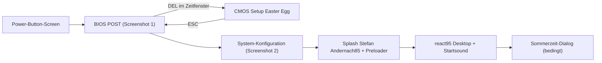

# Win98-Portfolio "Stefan Andernach85"

## Tech-Stack
- Vite + React + TypeScript, `react95` + `styled-components` + `@react95/icons` (Icons für den Desktop)
- Rein statisch, Deployment auf Netlify (`netlify.toml`, SPA-Redirect)
- Projekt in [sa85/](sa85/)

## Ablauf (State Machine in `App.tsx`)



- **Power-Button-Screen:** Browser blockieren Audio ohne Klick. Ein kleiner schwarzer Screen mit "Press Power" bzw. Klick auf einen Einschaltknopf startet alles. Erst dadurch funktionieren der Piep und später der Startsound.
- **Überspringen:** `ESC` bzw. `Leertaste` springt für wiederkehrende Besucher direkt zum Desktop.

## 1. DOS/BIOS-Boot-Screen (so würde ich ihn bauen)
- Komponente `BootScreen.tsx`: schwarzer Hintergrund, Monospace-Bitmapfont ("Perfect DOS VGA 437" als Webfont, ist frei nutzbar), Farben wie im Screenshot (hellblau/weiß/grün).
- **Zeitgesteuertes Skript** (`bootScript.ts`) als Liste von Schritten `{ delay, text, effect }`, so lassen sich Texte und Timing leicht anpassen:
  - Award-Header, "GREEN AGP/PCI/ISA SYSTEM", "PENTIUM II CPU at 450MHz"
  - **Memory Test hochzählend** (0K bis 65536K OK, per `requestAnimationFrame`) mit Speichertest-Ticken
  - Plug-and-Play-Zeilen, "Detecting IDE Primary Master ... ST34311A", "Primary Slave ... [Press F4 to skip]" mit blinkendem Cursor
  - Unten links "Press DEL to enter SETUP" plus BIOS-String-Zeile
- **POST-Piep:** per Web Audio API erzeugt (Rechteckwelle ca. 1 kHz, ca. 150 ms). Das braucht keine Datei und klingt wie ein PC-Speaker. Optional zusätzlich Lüfter- bzw. HDD-Rattern als MP3 im Preloader.
- **Energy-Star-Logo rechts oben:** als eigenes SVG nachgezeichnet (Bogen, Schriftzug, Stern, "EPA POLLUTION PREVENTER") in Grün bzw. Weiß. Das Reddit-Bild wird nicht eingebunden, weil Hotlinking unzuverlässig ist.
- **Mainboard-Logo oben links:** Platzhalter-Komponente `BoardLogo`, die sich später leicht tauschen lässt. Drei Vorschläge:
  1. **ASUS P2B** (440BX, passt exakt zu Pentium II, 450 MHz und dem Screenshot)
  2. **Abit BH6** (Kult-Board der Ära, bekannt fürs Übertakten)
  3. **ASUS P/I-P55T2P4** (falls es wirklich "Pentium 1" sein soll, Sockel 7)
  - Empfehlung: das Award-"Ribbon"-Icon wie im Screenshot plus ein eigenes, retro gestaltetes "SA85"-Board-Logo. So gibt es keine Markenprobleme.
- **Screen 2 (System-Konfiguration):** Nach dem POST ein Bildschirmwechsel zur Tabelle mit doppeltem Rahmen (Box-Drawing-Zeichen), PCI-Device-Listing und "Verifying DMI Pool Data ......", wobei die Punkte animiert erscheinen.

## 2. DEL-Easter-Egg (CMOS Setup)
- `keydown`-Listener nimmt `Delete` (und `Backspace` für Mac-Laptops) nur im Zeitfenster an, etwa 2,5 s während des Memory Tests.
- `BiosSetup.tsx`: klassisches blaues Award-"CMOS Setup Utility"-Layout (zweispaltiges Menü, gelbe Hervorhebung, Navigation mit den Pfeiltasten). Im Mittelpunkt steht ein Dialog: **"Welcome to the 90s. Congratulations that you found my small Easter egg."**
- Fußzeile: "ESC: Quit  F10: Save & Exit Setup", beide starten den Boot neu bzw. setzen ihn fort.

## 3. Splash "Stefan Andernach85" + Asset-Preloader
- `SplashScreen.tsx`: Vollbild mit Win98-Himmel (eigenes Hintergrundbild unter `public/img/splash-sky.jpg` oder per CSS nachgebaut).
  - Gleiche Anordnung wie beim Original: kleines "Stefan" oben (statt "Microsoft"), großes fettes "Andernach" (statt "Windows") und daneben die "85" im Stil der "98".
- **Verlaufsbalken unten:** CSS-Animation (`linear-gradient` in Blau, Weiß und Blau, Endlosschleife über `background-position`) wie beim Original-98-Splash.
- **Preloader** in `src/preload/`:
  - `manifest.ts`: Liste `{ type: 'image' | 'audio' | 'font' | 'module', src }`, anfangs mit Startsound, Icons, Wallpaper und Fonts. Später kommen hier Spiele bzw. Apps dazu (`module` lädt dann `import()`-Chunks vor).
  - `preloadAssets(manifest, onProgress)`: arbeitet parallel, mit Timeout pro Asset, und Fehler blockieren nichts.
  - Der Splash bleibt mindestens ca. 3 s stehen (für den Effekt) und höchstens ca. 10 s.

## 4. Desktop (react95)
- Hintergrund im Win95-Teal `#008080`, unten die `AppBar` mit Start-Button, Startmenü (`MenuList`), offenen Fenstern als Tasks und einer Uhr.
- **Startsound:** `win95.mp3` und `win98.mp3` liegen unter `public/sounds/`; standardmäßig läuft win98. Hinweis: Die Dateien sind von Microsoft urheberrechtlich geschützt, was für eine private Seite meist toleriert wird.
- **Fenster-Manager** (`WindowManager` mit Context): Fenster öffnen, schließen, minimieren, fokussieren (z-index) und per Titelleiste ziehen (eigene Pointer-Events, keine Extra-Library).
- **Erweiterbare App-Registry** `src/apps/registry.tsx`:

```ts
type DesktopApp =
  | { id: string; title: string; icon: IconComponent; kind: 'window'; component: LazyExoticComponent<FC>; defaultSize?: Size }
  | { id: string; title: string; icon: IconComponent; kind: 'link'; url: string };
```

  - Desktop-Icons werden aus der Registry gerendert, mit Doppelklick zum Öffnen und Auswahl-Highlight beim Einfachklick. Ein neues Spiel bzw. ein neuer Link braucht nur einen Registry-Eintrag.
- **Erste Apps** (Inhalte wie auf der Demo-Seite):
  - "Über mich" (Profil, Foto-Platzhalter, Kontaktdaten)
  - "Skills" (zunächst wie in der Demo, Progress-Bars bzw. Tree-View)
  - "Portfolio / Projekte"
  - "LinkedIn" (Link)
  - "Kontakt" (Formular)
  - "Arbeitsplatz" und "Papierkorb" als Deko
- Inhalte liegen zentral in `src/content/profile.ts`, damit Texte ohne Code-Änderung gepflegt werden können.

## 5. Sommerzeit-Dialog (Screenshot 4)
- `dst.ts` berechnet den letzten Sonntag im März und im Oktober (Europe/Berlin).
- Liegt das heutige Datum in den ersten 30 Tagen nach einer der beiden Umstellungen, erscheint nach dem Desktop-Load ein react95-`Window` "Neue Einstellungen" mit Uhr-Icon und dem Originaltext auf Deutsch.
- **Einmal pro Besucher:** `localStorage`-Key je Umstellungsperiode (z. B. `dst-2026-10`), damit der Dialog zur nächsten Umstellung wieder kommt.

## 6. Kontaktformular
- `ContactWindow.tsx` mit react95 `TextInput` (Name, E-Mail, Betreff, Nachricht multiline) und `Button` "Senden" bzw. "Abbrechen".
- Validierung, ein Honeypot-Feld und eine Win98-Fehlermeldung als Dialog.
- Senden läuft vorerst über einen austauschbaren `sendContact()`-Service (Stub mit Erfolgsdialog).

## Sektion: Anbindung Microsoft 365 (business@sa85.de), später
- **Option A (empfohlen): Netlify Function + Microsoft Graph `sendMail`**
  1. Im Entra Admin Center eine App registrieren und die Application Permission `Mail.Send` (Admin-Consent) vergeben.
  2. In Exchange Online den Zugriff der App auf genau ein Postfach beschränken (RBAC for Applications bzw. Application Access Policy), damit die App nicht aus allen Postfächern senden kann.
  3. In `netlify/functions/contact.ts` per Client Credentials einen Token holen und dann `POST https://graph.microsoft.com/v1.0/users/business@sa85.de/sendMail` aufrufen (`replyTo` = Absender des Formulars).
  4. Secrets (`TENANT_ID`, `CLIENT_ID`, `CLIENT_SECRET`) liegen als Netlify-Umgebungsvariablen. Zum Spam-Schutz kommen Cloudflare Turnstile und der Honeypot dazu.
  - Netlify Functions sind im Free-Tier enthalten, die Seite bleibt also ansonsten statisch.
- **Option B (ohne Code): Netlify Forms** mit `data-netlify="true"` und E-Mail-Benachrichtigung an business@sa85.de. Das ist am schnellsten, bietet aber weniger Kontrolle über Layout und Inhalt der Mails.
- **Option C:** Power Automate mit HTTP-Trigger und "Send an email (V2)". Das braucht allerdings eine Premium-Lizenz.

## Dateistruktur (Kern)
- `src/App.tsx` (Phasen-State-Machine)
- `src/boot/BootScreen.tsx`, `bootScript.ts`, `BiosSetup.tsx`, `SystemSummary.tsx`, `EnergyStarLogo.tsx`, `beep.ts`
- `src/splash/SplashScreen.tsx`, `src/preload/manifest.ts`, `preloadAssets.ts`
- `src/desktop/Desktop.tsx`, `Taskbar.tsx`, `StartMenu.tsx`, `DesktopIcon.tsx`, `WindowManager.tsx`
- `src/apps/registry.tsx`, `src/apps/*` (About, Skills, Portfolio, Contact)
- `src/content/profile.ts`, `src/utils/dst.ts`
- `public/sounds/win95.mp3`, `public/sounds/win98.mp3`, `public/fonts/`, `netlify.toml`
